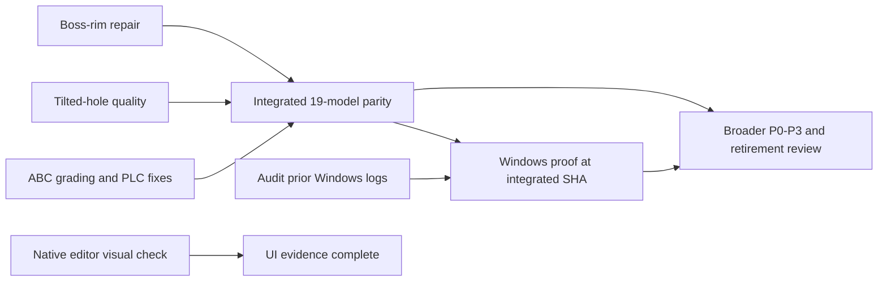

# Issue 46: five-plan execution master

Status: coordination plan, 2026-10-23. [Phase 137](issue-46-phase-137.md) reproduced the first boss-rim gate and found it still blocked by a larger cavity retriangulation proof; no later item has started. The live qualified-source state remains `docs/issue-46-current.json`.

## Plans and dependency graph

| ID | Plan | Owns | Can start when | Completion gate |
|---|---|---|---|---|
| B | [Boss-rim repair](issue-46-boss-rim-repair-plan.md) | `fea-core` boundary repair and its regressions | Immediately | Connected boss passes the default solver-quality gate without curved-body, face-fidelity or convergence regression; focused OCCT/native solves pass. |
| T | [Tilted-hole quality](issue-46-tilted-hole-quality-plan.md) | `solid-kernel` chart topology and synthetic overlap regressions | Immediately | Native tilted hole passes the default quality gate and same-STEP static solve; oblique/trimmed-face overlap protection holds. |
| W | [Windows feature-off runtime](issue-46-windows-runtime-plan.md) | Hosted Windows evidence; `fea-problem/tests/native_solid.rs` or workflow only if needed | Evidence audit immediately; final run after integrated mesher changes | At the exact candidate source revision, an `occt`-off Windows x64 test actually meshes STEP and solves, with quality and load/support evidence. Packaged offline acceptance is a separate later gate. |
| A | [ABC and remaining retirement gates](issue-46-abc-and-retirement-gates-plan.md) | `00006600` grading, `00007062` PLC, full parity and priority exits | PLC diagnosis immediately; grading source changes after T settles chart ownership; final parity after B, T and any retained ABC mesh changes | Each ABC file reaches its own stated stage/gate or records a bounded refusal; all 19 same-STEP pairs and broad checklist are evaluated on integrated source. |
| V | [Native editor browser visual check](issue-46-native-editor-browser-visual-plan.md) | Actual `app-tui --gpu-solid` window proof | Immediately, if an interactive macOS desktop is available | Visible window and valid/invalid Open flows are inspected. No dependency on the mesher plans. |

The arrows are **qualification dependencies**, not a reason to hold independent diagnosis. B and T may be implemented in parallel because their primary source ownership differs; both change the eventual volume mesh, so neither's focused parity result qualifies the combined source. `00007062` PLC diagnosis can proceed alongside them. `00006600` grading touches `solid-kernel` chart code near T and must wait for T's chart edits to settle, or use an explicitly disjoint branch with a deliberate integration review. V is independent. W's read-only log audit is independent, but its final result must be rerun or confirmed at the integrated candidate SHA if B/T/ABC changes affect the runtime path.

## Execution order and handoffs

1. **Establish the baseline.** Coordinator checks `git status`, `origin/main`/local head, CodeGraph freshness, disk space, OCCT availability and existing hosted Windows logs. Preserve `.claude/settings.json` and both recovery files. Record the current 19-model and numerical baselines from committed phase evidence; run only focused baseline cases needed to isolate a new finding. No historical document is deleted.
2. **Parallel first wave.** Assign B to an agent owning `fea-core/src/meshing/boundary_repair.rs` and `fea-core/tests/tetmesh_repair.rs`; T to an agent owning `solid-kernel/src/chart_mesh.rs` and its focused chart/STEP tests; V to an agent owning desktop observation and, only if a defect is verified, `app-tui` browser UI. The coordinator audits W's existing hosted logs and `00007062` PLC evidence. Agents read their crate `AGENTS.md` nodes and use CodeGraph before decisions. They do not edit each other's files or update the shared live pointer.
3. **Qualify and integrate each bounded increment.** Each code owner writes a failing regression, fixes the responsible layer, runs focused and touched-crate tests, and reports exact geometry, quality and solver results. The coordinator alone schedules Cargo so only one process uses this checkout's target at a time, reviews cross-crate effects, records append-only phase evidence, and performs forward-only branch/PR/plain-push/squash-merge operations. An increment that fails its own gate is reverted or left unmerged with a documented counterexample; it is not declared done because a diagnostic table exited zero. Merge qualified increments onto `main` before starting dependent changes. Rebase/force-push/history rewrite is forbidden.
4. **ABC second wave.** After T's chart interface is stable, assign `00006600` grading to the chart owner or a successor agent; assign `00007062` PLC recovery to an agent with exclusive ownership of `solid-kernel/src/plc_conform.rs` and its tests. These can run concurrently only with disjoint files, fixtures and diagnostic outputs. Reuse the same source revision and recorded resource budgets for comparable per-file results. A real small-angle or inconsistent-source refusal is an honest outcome; neither file is allowed to relax admission gates or consume unbounded work. Qualify and integrate retained changes separately.
5. **Combined parity gate.** After all retained mesher changes are integrated, run the 19-model same-STEP release table with both actual solves and the asserted comparison, on a single recorded commit. Explicitly evaluate all 38 rows against `QualityThresholds::default()`, face/load ownership and solver/efficiency metrics; the table's exit code alone is insufficient. Investigate any new regression in its owner before advancing. If a B, T or ABC change lands after this run, repeat the affected focused rows and the full parity qualification for the final source.
6. **Target-platform gate.** W may reuse an exact-SHA hosted Windows feature-off runtime result if the audit proves it already ran the STEP mesh and solve. Otherwise run the focused workflow/test on the integrated candidate. Record CPU/OS/build/features, actual test count, quality and equilibrium. A successful executable build, a zero-test filter and a test with `occt` enabled do not pass. Separately plan/execute clean-machine, offline packaged-app acceptance before any final release claim. If V finds a rendering defect, integrate its fix and repeat the visible-window check; repeat the Windows executable qualification if that fix changes its runtime path.
7. **Broad exit and approval boundary.** Use A's Track C and `docs/issue-46-completion-checklist.md` for remaining P0/P1/P2/P3 and per-model production parity. Record unsupported editor operations, licensing, B-rep healing, exact trims and cost/learning gaps explicitly. Technical success is followed by a reviewable retirement evidence package; only then request the separate owner approval required to remove OCCT or set `occt_retirement_approved` true. Keep OCCT production routing and the flag false until that approval.

## Parallel-work controls

- Maximum four active agents, including the coordinator. Delegate independent B/T/V work first; overlap ABC PLC diagnosis or Windows log audit only within available slots. Do not spawn a second agent on the same source file.
- One agent or coordinator owns each file during an increment. Shared parity harness and status docs have coordinator ownership; ask a worker for a patch/recommendation rather than concurrent edits there.
- All workers use this checkout's own target for qualification; never share a target across divergent worktrees. Serialize Cargo, record command exit codes and test counts, and check disk before long release runs. Build-time network in CI is allowed; the published Windows app must run offline, without admin or a preinstalled runtime.
- Use the local checkout as truth over remote snapshots. Preserve unrelated untracked files. Follow root and crate-level `AGENTS.md`, append-only `docs/` policy, unchanged numerical gates, progress/cancellation, exact geometry checks and regression tests. Fix other verified defects discovered in the same session under the root Fix-Everything policy, but keep their evidence and ownership separate.

## Source-of-truth rule

This master is a dependency map. The five linked plans own their detailed tests and stop conditions; `docs/issue-46-current.json` owns live execution status. If a new finding changes the dependencies, update this map with the reason before scheduling conflicting work. Passing B or T alone does not certify the final 19-model table, and passing the table does not itself approve OCCT retirement.
